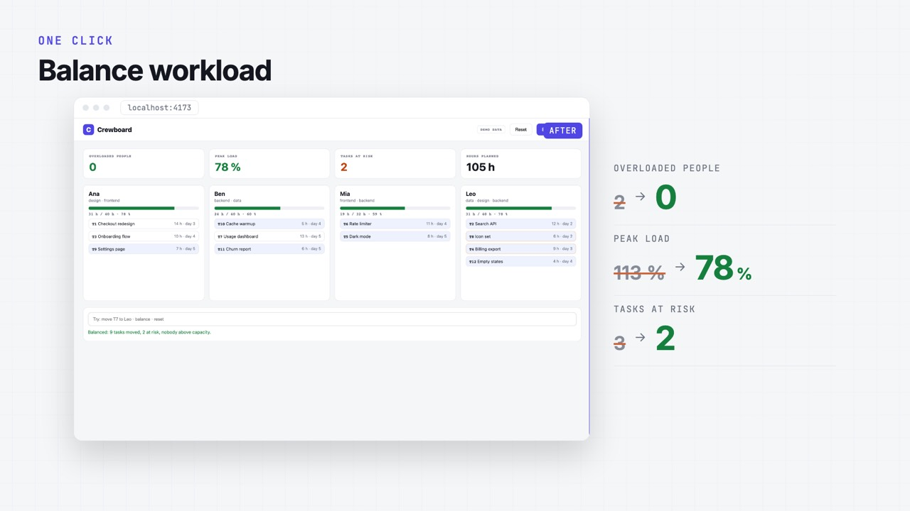
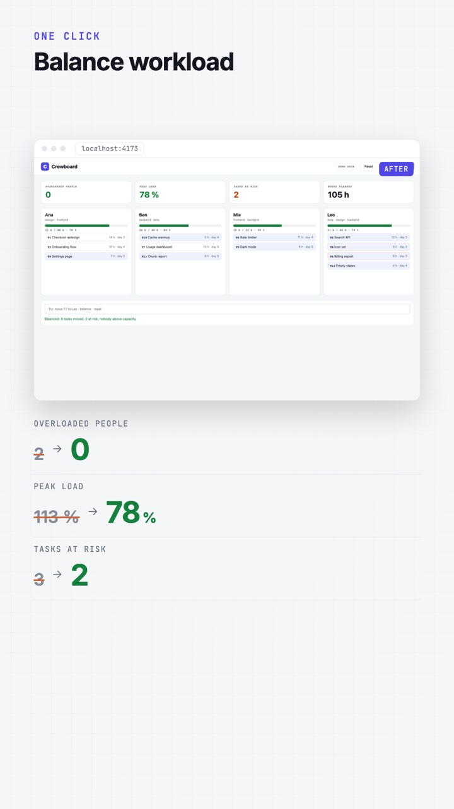
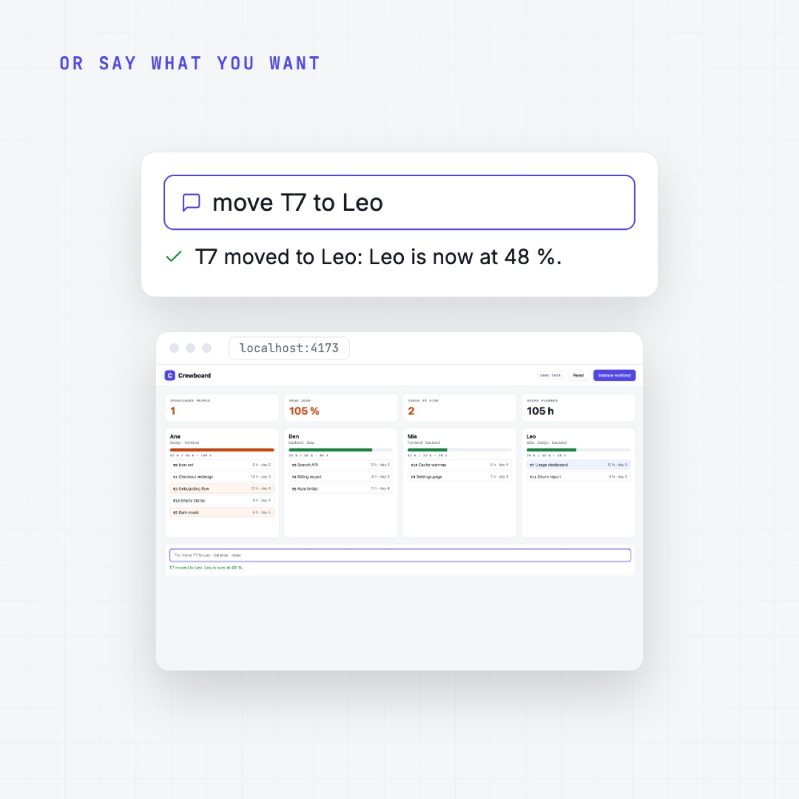
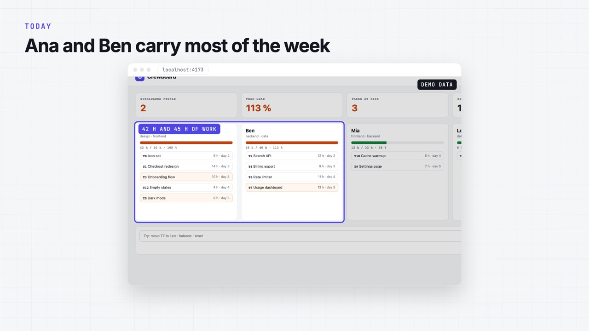
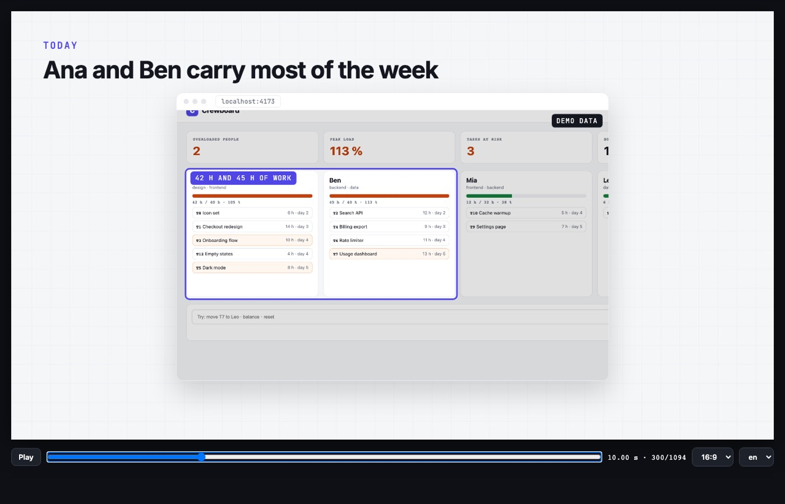

# code-to-video

**Turn a codebase or a running web prototype into a short, honest product video.**
Real screens, real numbers, any text-to-speech, rendered for the web, Reels/Shorts and LinkedIn.

`code-to-video` is an [Agent Skill](https://docs.claude.com/en/docs/claude-code/skills) for Claude
Code. Point it at a repo: it reads the code, runs the app, captures the real screens with
Playwright, measures what the product actually does, writes a storyboard with you, composes the
video with its own frame engine (React scenes photographed frame by frame, encoded by ffmpeg), adds
an optional voice-over, renders 16:9, 9:16 and 1:1, and checks the result. MIT all the way down:
no video framework, no render service, no license to buy.



| 9:16 | 1:1 | 16:9 |
|---|---|---|
|  |  |  |



Example output: [`docs/crewboard-demo.mp4`](docs/crewboard-demo.mp4) (36 s preview, voice by macOS
`say`), made from the tiny demo app in [`examples/demo-app`](examples/demo-app).

## Why

Product videos are usually made twice: once in code, once again in a video editor with mock-ups
that drift from the product. This skill makes the video from the product itself, with rules that
keep it honest:

- **Real screens only**: every frame of UI is captured from the running app.
- **Real numbers only**: every figure comes from the product's own output, with its source;
  demo or synthetic data is tagged on screen.
- **Honest comparisons**: before/after against what people really do today, not a strawman.
- **A prototype is called a prototype**, never "live".
- **Two human gates**: you approve the storyboard and a low-res preview before the voice and the
  final render.

## Install

In Claude Code:

```
/plugin marketplace add WizzyDev997/code-to-video
/plugin install code-to-video@code-to-video
```

Or copy `skills/code-to-video/` into `~/.claude/skills/` (all your projects) or
`.claude/skills/` (one project).

**Requirements:** Node 20+, ffmpeg, and a Chromium for Playwright (`npx playwright install
chromium`). Optional: a TTS key, and the `whisper` CLI to pick the cleanest voice take.

## Use

Open your project in Claude Code and ask:

> Make a 60-second product video of this app.
> Make a vertical 30 s clip showing the new export feature, French and English.
> Turn this prototype into a demo video for the sales call, no voice, captions only.

The skill walks through eight steps:

| Step | What happens |
|---|---|
| 1 · Understand | reads the README, routes and main screens; writes a 6-line brief |
| 2 · Run | starts the app locally |
| 3 · Capture | screenshots and short recordings with Playwright (`capture.json`) |
| 4 · Measure | the numbers the video will quote, from the product itself |
| 5 · Storyboard | 5 to 7 scenes, one message each (`video.config.json`), **you approve** |
| 6 · Preview | half-resolution render and a contact sheet, **you approve** |
| 7 · Voice | optional voice-over, mixed at -16 LUFS |
| 8 · Render + QA | every format and language, checked for duration and loudness |

## Voice-over: any TTS

Built in: **Deepgram**, **ElevenLabs**, **OpenAI**, and `command`, which runs any CLI (macOS `say`,
piper, espeak, Coqui, a local model). Keys come from the environment or a `.env` file:
`DEEPGRAM_API_KEY`, `ELEVENLABS_API_KEY`, `OPENAI_API_KEY`. Adding another provider is one function
in `scripts/voice.mjs`. See [references/voice.md](skills/code-to-video/references/voice.md):
respelling product names for the voice, several takes picked by transcript, lines that fit their
scene.

## Try it on the example

```bash
git clone https://github.com/WizzyDev997/code-to-video && cd code-to-video
node examples/demo-app/server.mjs &                # the demo app on http://localhost:4173
cp -R skills/code-to-video/template my-video && cd my-video
npm install
node scripts/capture.mjs                           # real screens of the demo app
node scripts/studio.mjs                            # preview player on http://localhost:3000/?player=1 (Ctrl+C to stop)
node scripts/render.mjs --preview --format 16:9    # half-res preview in out/
node scripts/qa.mjs                                # duration, loudness, contact sheet
node scripts/voice.mjs --provider command          # optional: voice with macOS say (no key)
node scripts/mix.mjs && node scripts/render.mjs    # final, every format
```

Preview while you edit with `node scripts/studio.mjs` (a small player: play, scrub, switch format
and language). If Playwright's browser is not installed, set `CHROMIUM_PATH` to any Chrome or
`chrome-headless-shell`, see [render-and-qa.md](skills/code-to-video/references/render-and-qa.md).

## How rendering works

The scenes are React components that read the current frame number and nothing else. To render, a
page is opened in headless Chrome; for each frame the renderer sets the frame, waits until fonts and
images are ready, and takes a screenshot of the stage, several pages in parallel. ffmpeg encodes the
screenshots and the soundtrack into the MP4. Because every frame depends only on its number, a
frame always looks the same, and the result is reproducible.

## What is inside

```
skills/code-to-video/
  SKILL.md                 the pipeline and the rules the agent follows
  references/              storyboard, capture, voice, render and QA
  template/                a complete video project
    video.config.json      the storyboard: scenes, theme, fonts, voice, formats, languages
    capture.json           what to capture in the running app
    src/scenes/            title, screen, clip, compare, metrics, typing, features, outro
    src/engine/            the frame engine: time, sequences, interpolate, spring, easing
    scripts/               capture, build, studio, render, voice, mix, qa
examples/demo-app/         Crewboard, a fictional team-workload board used for the example
```

## Licenses

MIT. The dependencies are open source too: React (MIT), Playwright (Apache-2.0), esbuild (MIT),
ffmpeg (LGPL/GPL, used as a command-line tool), the bundled fonts (SIL Open Font License). Music and
voices you add are under their own terms.

## Contributing

Issues and pull requests are welcome: new scene types, TTS providers, capture actions, layouts.
Keep the rules: real screens, real numbers, honest comparisons.
